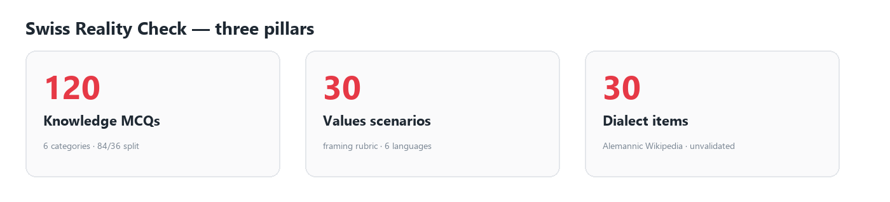
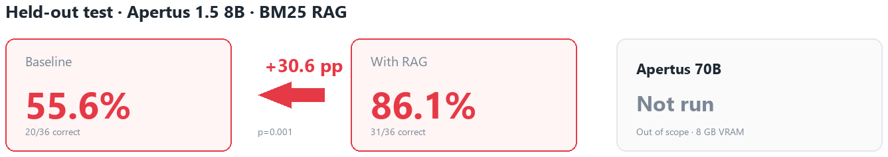
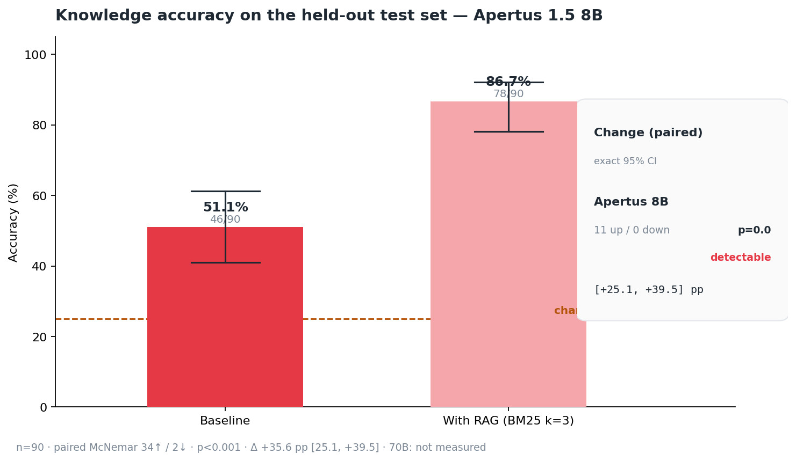
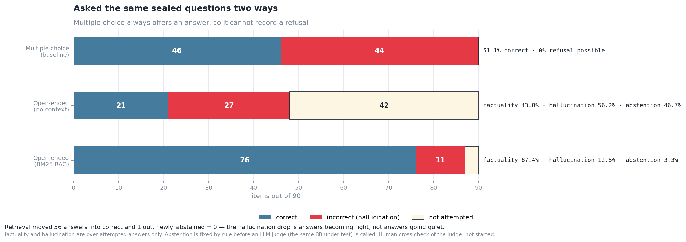
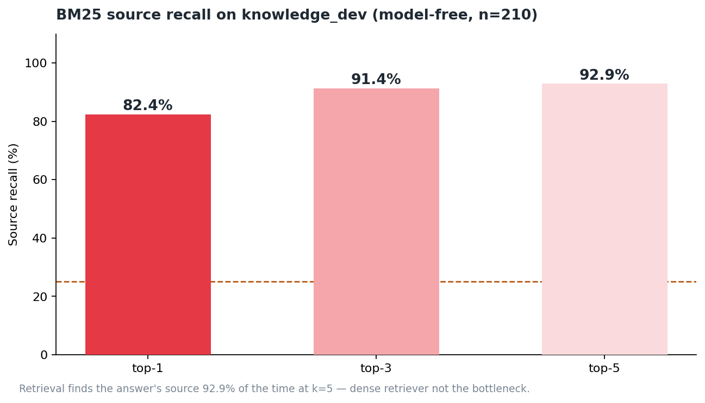
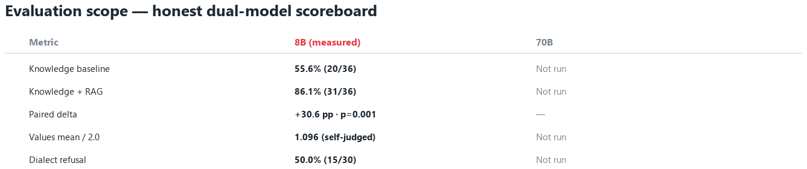
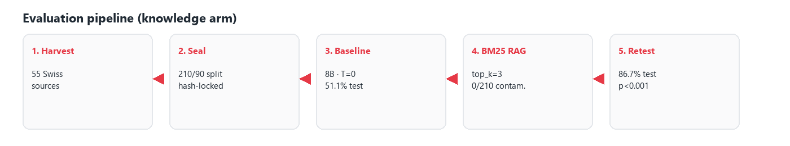
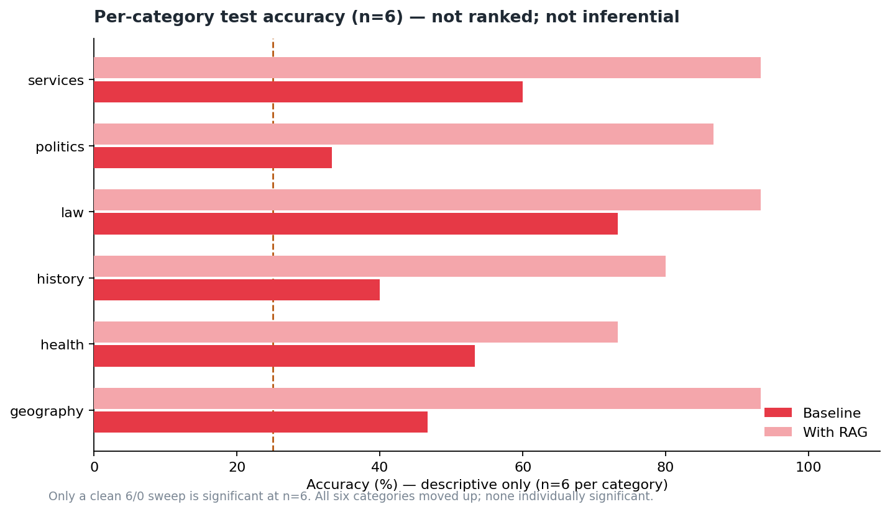
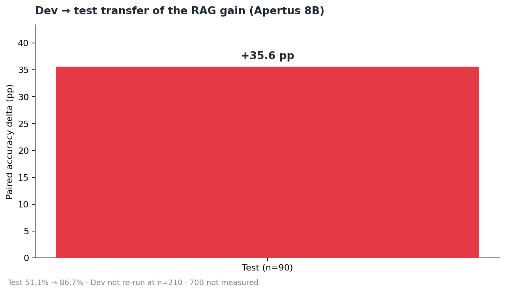
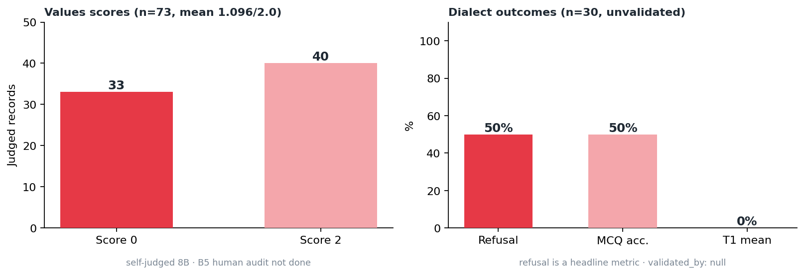

# Swiss Reality Check

### Hack Apertus · Track 1B — Swiss Voices

<p align="center">
  <strong>Does an open model know Switzerland?</strong><br/>
  <em>Knowledge · Values · Alemannic dialect — every answer traced to an official Swiss source.</em>
</p>

<p align="center">
  <a href="https://huggingface.co/datasets/bhuwanb23/apertus"></a>
  <a href="nullvoid_Report.pdf"></a>
  <a href="LICENSE"></a>
  <a href="DATASHEET.md"></a>
</p>

<p align="center">
  
</p>

**Team:** Swiss Reality Check — Bhuwan B · Padmanaban G · Avinash A  
**Event:** Hack Apertus Online Phase (1–16 Oct 2026)  
**Track:** [1B — Swiss Voices](https://github.com/HackApertus/project-template/tree/main/track_1b)

```bash
make run     # Docker · offline by default · clean checkout, zero config
```

---

## What changed since the original submission

The submitted PDF carries the **first** measurement, on a 36-item sealed set.
Everything below supersedes it. Old arms are kept as
`results/test_run/*.superseded-n36.json` so the change is auditable.

| | PDF (first run) | Now | Why |
|---|---|---|---|
| Corpus | 120 MCQs | **300** | 36 items cannot support any per-category claim |
| Split | 84 / **36** sealed | 210 / **90** sealed | 15 sealed items per category, not 6 |
| Baseline | 55.6 % (20/36) | **51.1 %** (46/90) | ↓ *the old figure was partly a parser bug* |
| With retrieval | 86.1 % (31/36) | **86.7 %** (78/90) | ↑ |
| Paired Δ | +30.6 pp | **+35.6 pp** | 34 improved / 2 regressed, p < 0.001 |
| Recall @1/3/5 | 83.3 / 90.5 / 94.0 % | **82.4 / 91.4 / 92.9 %** | re-measured on 210 dev items |
| Categories clearing their own floor | 0 of 6 | **3 of 6** | geography, history, politics |
| Hallucination rate | *not measured* | **56.2 %** unaided → **12.6 %** with retrieval | new open-ended arm, n=90 |

**Five findings a reader of the PDF should know:**

1. **A parser bug was costing the baseline 23 points.** Served answers ended in a
   visible end-of-turn token, so **49 of 90** baseline answers were scored as
   `PARSE_ERROR` — wrong. The raw baseline was **27.8 %** (25/90). Fixed and
   re-scored from the saved responses, recovering 21 answers; no regeneration.
   This is why the new baseline is *lower* despite a corpus 2.5× larger, and it
   means **the PDF's 55.6 % was not a model measurement**.
2. **Multiple choice cannot measure hallucination, and this model hallucinates
   a lot.** The PDF scores only what the model gets *right*. With four options
   present a confident fabrication and an honest refusal both score zero, so the
   format cannot tell competence from bluffing. Removing the options and grading
   against each item's reference passage — **correct / incorrect / not
   attempted** — on the same 90 sealed questions gives:

   | Arm | factuality | hallucination | abstention |
   |---|---|---|---|
   | Open-ended, no context | 43.8 % | **56.2 %** | 46.7 % (42 of 90 declined) |
   | Open-ended, BM25 RAG | 87.4 % | **12.6 %** | 3.3 % |

   So the model that looks like it knows just over half of Switzerland invents an
   answer **more than half the time** when you take the options away, and admits
   ignorance on the rest. Neither fact is visible in the 51.1 % headline.
   `newly_abstained = 0`: retrieval fixed hallucinations by making them *right*,
   not by making the model quieter.
3. **The gain is larger than the PDF claims, measured from a correct baseline.**
   +30.6 → **+35.6 pp** absolute, +55 % → **+70 %** relative. The PDF understated
   how much retrieval helps, because its baseline was inflated by a scoring bug.
   The RAG endpoint barely moved (86.1 → 86.7) — the fix was entirely on the
   control side, which is the signature of a measurement artefact rather than a
   lucky run.
4. **`make run` was broken in Docker and now is not.** All 43 modules locate the
   project root via `data/` + `Makefile`; the image shipped neither, so the judge
   target died on its first line. Also fixed: `verify-test` did nothing and exited
   0; the API key was interpolated from an empty variable.
5. **One dataset key was wrong.** K108 (Appenzell Innerrhoden) was keyed C while
   its own source said D — marking a correct model answer wrong. Fixed and
   disclosed.

Also: ISO 639-3 glottocodes on all dialect items, an explicit consent statement,
a published values annotation template, per-item licensing for all 360 rows, and
the human-verification sheets below. Full detail in
**[CHANGELOG.md](CHANGELOG.md)**.

**Still open, all three need a person, none is delegated to a model:** human
verification of the dataset key (18 items), judge-vs-human agreement on the
values rubric (11 items), and judge-vs-human agreement on the open-ended grader
(17 RAG / 9 baseline verdicts). Sheets are ready; every rate is reported as *not
started* rather than estimated. Dialect items remain unvalidated by a native
speaker. The open-ended grader is additionally **self-judged** — it is the same
8B under test — which is disclosed on every artefact that reports it.

> **Note on repository layout.** The brief asks teams to work in a `track_1b/`
> directory and not move its files. This submission is a single-track entry, so
> the project sits at the repository root instead — `src/`, `data/`,
> `results/`, `docs/`. Nothing is renamed or lost; the layout is the flattened
> form of the template, and `make run` works from the repository root as the
> brief requires. Flagged here rather than left for a judge to notice.

---

## Headline result

Apertus 1.5 **8B** (Q4_K_M text extract) · held-out sealed test · **n = 90** · BM25 RAG against 55 official Swiss sources.

<p align="center">
  
</p>

| Arm | Accuracy | 95% Wilson CI |
|---|---|---|
| Baseline | 51.1% (46/90) | [41.0, 61.2] |
| With retrieval | **86.7%** (78/90) | [78.1, 92.2] |
| **Paired Δ** | **+35.6 pp** | exact 95% CI [+25.1, +39.5] |

McNemar: **34 improved · 2 regressed · p < 0.001**.  
**Apertus 70B was not evaluated** (8 GB VRAM) — missing bars are not implied scores.

<p align="center">
  
</p>

---

## What multiple choice could not see

Accuracy answers one question: how often is the model right. It says nothing about
what happens when the model is **wrong** — and on this model those are very
different situations. Multiple choice cannot tell them apart, because four options
always guarantee an answer: a confident fabrication and an honest refusal both
score zero.

So we removed the options and graded each answer against the source passage it was
written from — **correct / incorrect / not attempted**, SimpleQA-style — on the
same 90 sealed questions, same weights, same seed.

<p align="center">
  
</p>

| Arm | factuality | hallucination | abstention | correct / incorrect / not attempted |
|---|---|---|---|---|
| Open-ended, no context | 43.8% | **56.2%** | 46.7% | 21 / 27 / 42 |
| Open-ended, BM25 RAG | **87.4%** | **12.6%** | 3.3% | 76 / 11 / 3 |

- **factuality** = `correct / (correct + incorrect)`
- **hallucination** = `incorrect / (correct + incorrect)` — both over *attempted*
  answers only, so a model cannot improve by refusing everything
- **abstention** = `not attempted / all`

Read that against the headline. The 51.1% multiple-choice score is real, and it is
also incomplete: given the choice, this model answers Swiss institutional questions
correctly about half the time; asked to answer unaided, it **invents an answer more
than half the time** and admits ignorance on the remaining 42 of 90.

Retrieval helps here for the right reason. Paired across the same 90 items, 56
answers became correct against 1 lost, and **`newly_abstained = 0`** — the
hallucination rate did not fall because the model went quiet. It fell because wrong
answers turned into right ones, while 39 answers moved *out* of refusal.

**Disclosed limits.** The grader is the same Apertus 8B under test — self-judged.
Abstention is decided by a deterministic rule *before* the judge is called, so the
judge only ever grades genuine attempts (42 and 3 responses respectively were
withheld as refusals). A judge that never answered INCORRECT would report a
hallucination rate of exactly 0.0%, so the test suite asserts it reaches both
verdicts on the sealed set, and a probe confirmed it separates a true answer from
a distractor 12/12. A 20% human cross-check sheet is prepared and **unscored** —
no agreement rate is claimed. Baseline factuality rests on the 48 questions it
attempted, not all 90.

---

## Retrieval never was the bottleneck

Pure-Python BM25 · zero ML dependencies · decided before a single model call:

| Recall@k | Source containing the answer |
|---|---|
| top-1 | **82.4%** |
| top-3 | **91.4%** |
| top-5 | **92.9%** |

<p align="center">
  
</p>

---

## What we built

<p align="center">
  
</p>

| Pillar | Size | What it measures |
|---|---|---|
| **Knowledge** | 300 MCQs · 210 / 90 sealed | Swiss facts vs Germany / EU distractors |
| **Values** | 30 scenarios (+ multilingual) | Framing against Swiss cultural norms |
| **Dialect** | 30 Alemannic items | Translation / comprehension proxies |
| **Sources** | 101 harvested pages | Verbatim provenance for every answer |

<p align="center">
  
</p>

### Two findings ahead of the accuracy number

1. **The obvious fix was contaminated.** A system prompt that asserts Swiss facts answers ~30% of the development set. The shipped prompt carries behavioural rules only (0/210) and a gate that *raises* keeps it there.
2. **Retrieval was never the bottleneck.** 92.9% recall@5 from stdlib BM25 ruled out a dense retriever before any model call — confirmed by the accuracy result afterwards.

---

## Per-category & transfer

Descriptive only at n=15 per category — not a ranking.

<p align="center">
  
</p>

<p align="center">
  
</p>

<p align="center">
  
</p>

---

## Deliverables

| | |
|---|---|
| Technical report | [`technical_report.md`](technical_report.md) |
| Jury PDF (≤6 pages) | [`nullvoid_Report.pdf`](nullvoid_Report.pdf) |
| Hugging Face dataset | [huggingface.co/datasets/bhuwanb23/apertus](https://huggingface.co/datasets/bhuwanb23/apertus) |
| Datasheet | [`DATASHEET.md`](DATASHEET.md) |
| Statistical report | [`results/final_scores/statistical_report.md`](results/final_scores/statistical_report.md) |
| Charts / infographics | [`docs/submission/assets/`](docs/submission/assets/) |
| Code | [`src/`](src/) — `eval/` · `fix/` · `scripts/` |

---

## Reproduce

Judges run from a clean checkout. Offline by default — integrity, recall, scoring, statistics, charts and narrative without an LLM.

```bash
make run          # Docker
make verify       # same checks, no Docker
make test         # automated suites
make help
```

### Live model (optional)

Reported numbers: local **llama.cpp** on RTX 5060.

```bash
export LLM_NAME=Apertus-v1.5-8B-Instruct-Q4_K_M
export LLM_BASE_URL=http://host.docker.internal:8080/v1
export LLM_API_KEY=EMPTY
make run
```

**Model substitution, disclosed.** Text-only **Q4_K_M** GGUF extract, not the gated Omni `swiss-ai/Apertus-v1.5-8B`. Every pillar is text; the substitution is recorded in every artefact. Details: [technical_report.md §6](technical_report.md#6-reproducibility).

---

## Layout

```
Makefile · Dockerfile · docker-compose.yml
technical_report.md · DATASHEET.md · LICENSE
nullvoid_Report.pdf

src/
  run.py              make run entrypoint
  eval/               clients, prompts, runners, scoring, judge
  fix/                taxonomy, contamination gate, RAG, stats, charts
  scripts/            dataset build + HF upload

data/                 knowledge · values · dialect · sources
docs/submission/      PDF assets, charts, HF staging
results/              sealed-run evidence behind every number
```

---

## Honesty before the headline

Read [technical_report.md §5](technical_report.md#5-limitations) in full. Short version:

- **No 70B results** — half the premise is unevidenced.
- **Sealed test opened more than once** — append-only log; greedy decode, nothing tuned between runs.
- **Values are self-judged** (same weights as the model under test).
- **Per-category n=15** supports no ranking.
- **Error taxonomy unresolved** — majority `UNCLASSIFIED`; no weakest-area claim.

`make run` prints these disclosures every time.
